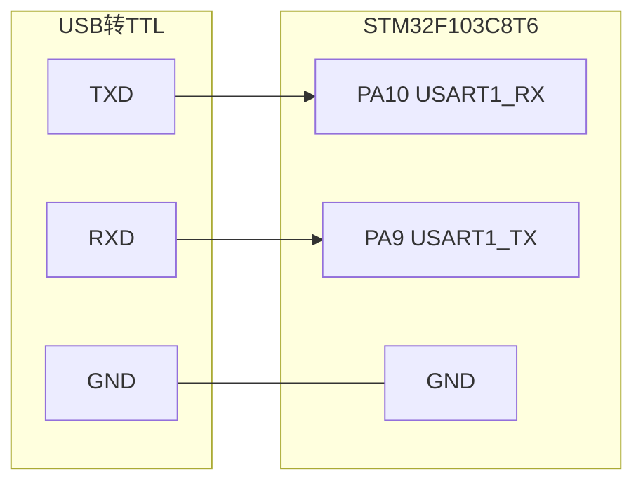

# exp2：STM32 点灯与定时器中断

本实验基于 **STM32F103C8T6 最小系统板**，完成两个工程：

- `1-1 LED闪烁`：使用 SysTick 延时，让 PC13 上的板载 LED 闪烁。
- `2-1 定时器定时中断`：使用 TIM2 定时中断，在 PA0 上输出 SOS 闪灯信号（`... --- ...`）。


## 三、接线

### 3.1 供电

最小系统板有三种常见供电方式：

| 方式 | 接法 | 说明 |
| --- | --- | --- |
| Micro USB 供电 | 板载 USB 口接电脑/充电器 | 最方便，板载稳压到 3.3V |
| 3.3V 供电 | 外部 3.3V 接板子 `3.3V` 引脚 | 必须稳压 3.3V |
| 5V 供电 | 外部 5V 接板子 `5V` 引脚 | 板载 LDO 会降到 3.3V |

> **严禁把 5V 接到 `3.3V` 引脚**，会直接烧坏芯片。  
> 做串口 ISP 时，推荐让最小系统板用 USB 独立供电，USB 转 TTL 只接 **TX、RX、GND** 三根线。

### 3.2 串口 ISP 接线（核心）

STM32F103 内置 Bootloader 使用 **USART1**，对应引脚：

- `PA9`：USART1_TX
- `PA10`：USART1_RX

USB 转 TTL 与 STM32 的接线必须 **交叉连接**：

| USB 转 TTL | STM32F103C8T6 | 说明 |
| --- | --- | --- |
| `GND` | `GND` | **必须共地**，否则无法通信 |
| `RXD` | `PA9`（USART1_TX） | 模块收，单片机发 |
| `TXD` | `PA10`（USART1_RX） | 模块发，单片机收 |
| `3.3V` | `3.3V` | 可选；板子已独立供电时不要接 |
| `5V` | `5V` | 不推荐，且绝不能接到 3.3V 引脚 |



> 记忆口诀：**TX 接 RX，RX 接 TX，GND 接 GND**。

### 3.3 BOOT 引脚设置

STM32F103 的启动模式由 `BOOT0` 和 `BOOT1`（即 PB2）决定：

| 启动模式 | BOOT0 | BOOT1 / PB2 | 用途 |
| --- | --- | --- | --- |
| 主闪存存储器 | 0 | 任意 | 正常运行用户程序 |
| 系统存储器 | 1 | 0 | **串口 ISP 烧录** |
| 内置 SRAM | 1 | 1 | 调试用，一般不用 |

Blue Pill 最小系统板上通常有一个 3Pin 的 BOOT 跳线帽：

- 跳线帽接 **0**：BOOT0 = 0，正常运行。
- 跳线帽接 **1**：BOOT0 = 1，进入系统 Bootloader。

BOOT1 在多数 Blue Pill 上由 PB2 通过 10kΩ 电阻下拉到 GND，默认就是 0；如果板子引出了 BOOT1，烧录时把它接 GND。

> **BOOT 引脚只在复位时被采样**。修改跳线帽后，必须按一下 **NRST 复位键**，芯片才会进入对应启动模式。

### 3.4 LED 接线

| 工程 | LED 引脚 | 接法 | 说明 |
| --- | --- | --- | --- |
| `1-1 LED闪烁` | PC13 | 无需接线 | 使用板载 LED，低电平点亮 |
| `2-1 定时器定时中断` | PA0 | `3.3V → 1kΩ → LED+ → LED- → PA0` | 低电平点亮 |

如果你想让 `2-1` 工程直接使用板载 PC13 LED，把 `main.c` 中的 `GPIOA / GPIO_Pin_0` 改成 `GPIOC / GPIO_Pin_13` 即可。

### 3.5 接线检查清单

烧录前逐项确认：

- [ ] USB 转 TTL 的 TX 接 PA10，RX 接 PA9，没有接反。
- [ ] STM32 与 USB 转 TTL 已共地。
- [ ] 没有把 5V 接到 3.3V。
- [ ] BOOT0 = 1，BOOT1 = 0。
- [ ] 上电后电源指示灯正常，芯片没有明显发烫。
- [ ] 杜邦线没有松动、短路。

---

## 四、STM32 烧录方法总览

STM32F103 常用烧录方式对比如下：

| 方式 | 接口 | 是否需要调试器 | 是否需要设置 BOOT | 特点 |
| --- | --- | --- | --- | --- |
| **串口 ISP** | USART1：PA9 / PA10 | 不需要，只需 USB 转 TTL | **需要**，BOOT0=1 后复位 | 成本最低，本实验采用 |
| ST-Link SWD | SWDIO=PA13，SWCLK=PA14 | 需要 ST-Link | 不需要 | 可下载、可在线调试，最常用 |
| J-Link | JTAG / SWD | 需要 J-Link | 不需要 | 功能强，价格较高 |
| USB DFU | USB：PA11 / PA12 | 不需要 | 需要 BOOT0=1 | 部分 F103 型号支持，需安装 DFU 驱动 |

本实验选择 **串口 ISP**：走芯片内置 Bootloader，接 UART1，需设置 BOOT 引脚并复位，无需调试器。

---

## 五、串口 ISP 烧录详解

### 5.1 原理

STM32F103 出厂时，芯片内部系统存储器（System Memory）中固化了一段 **Bootloader**。当复位时检测到：

```text
BOOT0 = 1，BOOT1 = 0
```

芯片不会运行用户 Flash 中的程序，而是运行这段系统 Bootloader。Bootloader 通过 **USART1（PA9/PA10）** 接收上位机发来的程序，并写入主 Flash。烧录完成后，把 BOOT0 改回 0 再复位，芯片就从主 Flash 启动，运行刚下载的程序。

因此串口 ISP 的关键三步是：

1. **接线正确**：USB 转 TTL 的 TX/RX 交叉接到 PA10/PA9，并共地。
2. **进入 Bootloader**：BOOT0=1、BOOT1=0，按复位。
3. **上位机下载**：FlyMcu 选择 HEX 文件并开始编程。

### 5.2 一次性准备

#### （1）安装 USB 转串口驱动

以 CH340 为例：

1. 把 USB 转 TTL 插入电脑。
2. 安装 CH340 驱动（Windows 10/11 也可能自动安装）。
3. 打开“设备管理器 → 端口（COM 和 LPT）”，确认出现类似 `USB-SERIAL CH340 (COM3)` 的设备。
4. 记住 COM 号，FlyMcu 中要选择同一个端口。

如果设备管理器中出现黄色感叹号，说明驱动未装好；如果插拔后没有反应，先换一根 **支持数据通信** 的 USB 线。

#### （2）安装 FlyMcu

FlyMcu（旧称 mcuisp）是常用的 STM32 串口 ISP 下载软件。打开后主要用到以下区域：

- 端口选择
- 波特率
- HEX 文件选择
- “开始编程”按钮
- 下载日志窗口

#### （3）用 Keil 生成 HEX 文件

工程默认已经开启 HEX 输出，输出路径为：

```text
1-1 LED闪烁/Objects/Project.hex
2-1 定时器定时中断/Objects/Project.hex
```

如果没有生成，按以下步骤设置：

1. 打开 Keil 工程。
2. 点击 `Options for Target`（魔术棒图标）。
3. 进入 `Output` 选项卡。
4. 勾选 `Create HEX File`。
5. 点击 `OK`，按 `F7` 重新编译。
6. 在 `Objects` 目录下找到 `Project.hex`。

> 注意：Keil 编译成功不等于已经下载，必须把 HEX 文件通过 FlyMcu 烧录进芯片。

### 5.3 进入 Bootloader

1. 断开 STM32 电源。
2. 把 BOOT0 跳线帽从 `0` 改到 `1`。
3. 确认 BOOT1/PB2 为低电平（多数板子默认已下拉）。
4. 给 STM32 上电。
5. 按一下 `NRST` 复位键（重新上电也可以）。
6. 此时芯片进入系统 Bootloader，等待串口下载。

> 如果板子上没有 BOOT0 跳线帽，可以用杜邦线把 BOOT0 接到 3.3V，烧录完成后再接回 GND。

### 5.4 FlyMcu 配置

| 配置项 | 推荐值 | 说明 |
| --- | --- | --- |
| 端口 | CH340 对应的 COM 口 | 在设备管理器中确认 |
| 波特率 | `115200` | 不稳定时可降到 `57600` 或 `38400` |
| 校验位 | 无 / None | FlyMcu 默认即可 |
| 数据位 | 8 | 默认 |
| 停止位 | 1 | 默认 |
| HEX 文件 | `Objects/Project.hex` | 选择刚编译出的文件 |
| 编程后执行 | 勾选 | 下载完成后尝试运行 |
| 校验 | 勾选 | 下载后校验数据 |
| DTR/RTS 自动控制 | 可选 | 需模块 DTR/RTS 已接到 NRST/BOOT0 |

如果 USB 转 TTL 模块引出了 `DTR` 和 `RTS`，可以这样接，实现 FlyMcu 自动复位并进入 Bootloader：

```text
USB-TTL DTR ── 0.1μF 电容 ── STM32 NRST
USB-TTL RTS ──────────────── STM32 BOOT0
USB-TTL GND ──────────────── STM32 GND
```

然后在 FlyMcu 中勾选类似 **“DTR 的低电平复位，RTS 高电平进 BootLoader”** 的选项。没有 DTR/RTS 时不必强求，手动设置 BOOT0 并按复位即可。

### 5.5 下载步骤

1. 按 5.3 节让芯片进入 Bootloader。
2. 打开 FlyMcu，选择正确的 COM 口和 `115200` 波特率。
3. 点击“选择文件”，选中 `Objects/Project.hex`。
4. 勾选“校验”和“编程后执行”。
5. 点击 **“开始编程”**。
6. 观察日志窗口，正常情况下会依次出现：
   - 连接芯片成功
   - 擦除 Flash
   - 写入程序
   - 校验成功
   - 编程完成
7. 下载完成后，把 BOOT0 跳线帽改回 `0`。
8. 按一下 `NRST` 复位键，程序开始运行。

### 5.6 验证是否烧录成功

以 `1-1 LED闪烁` 为例：

- 烧录前：板载 PC13 LED 可能常亮或状态不定。
- 烧录后：PC13 LED 应以约 **1 秒亮、1 秒灭** 的节奏闪烁。

以 `2-1 定时器定时中断` 为例：

- 若使用 PA0 外部 LED，应看到 SOS 节奏闪烁：`... --- ...`。
- 若使用板载 PC13，需要先按 3.4 节修改引脚定义。

### 5.7 常见问题排查

| 现象 | 可能原因 | 解决方法 |
| --- | --- | --- |
| 设备管理器没有 COM 口 | 驱动未装、USB 线只能充电、模块损坏 | 装 CH340 驱动，换数据线，换 USB 口 |
| FlyMcu 一直等待/连接超时 | BOOT0 没置 1、没按复位、TX/RX 接反、未共地 | 检查 BOOT0=1，按 NRST，交换 TX/RX，接好 GND |
| 能识别芯片但下载失败 | 波特率过高、供电不稳、HEX 文件不对 | 降到 57600，换供电，确认选对 HEX |
| 下载成功但程序不运行 | BOOT0 仍为 1、没复位、LED 接法不对 | BOOT0 改回 0，按复位，检查 LED 极性 |
| 芯片发烫 | 电源短路、5V 误接 3.3V、LED 没限流 | **立即断电**，检查接线 |
| 提示 Flash 容量不足 | 芯片型号选错或程序超过 64KB | 确认器件为 STM32F103C8，精简程序 |
| 下载后再次无法连接 | 程序禁用了调试口或进入低功耗 | 重新设置 BOOT0=1 并复位，进入 Bootloader |

> 串口 ISP 的通信参数本质上是 **115200、8 数据位、1 停止位、偶校验（8E1）**，FlyMcu 会自动处理；如果使用其他串口 ISP 工具，需要手动设置 8E1。

---

## 六、SOS 代码

### 6.1 代码位置

| 文件 | 作用 |
| --- | --- |
| `2-1 定时器定时中断/User/main.c` | GPIO 初始化、TIM2 中断服务函数、SOS 状态控制 |
| `2-1 定时器定时中断/System/Timer.c` | TIM2 初始化：预分频、自动重装、NVIC |
| `2-1 定时器定时中断/System/Delay.c` | SysTick 微秒/毫秒延时 |

### 6.2 定时器参数

`Timer.c` 中的关键配置：

```c
TIM_TimeBaseInitStructure.TIM_Prescaler = 7200 - 1;
TIM_TimeBaseInitStructure.TIM_Period = 10000 - 1;
```

TIM2 挂载在 APB1 总线上，定时器时钟为 **72MHz**：

```text
计数频率 = 72MHz / 7200 = 10kHz
中断周期 = 10000 / 10kHz = 1s
```

也就是说，当前 `Timer.c` 实际是 **1 秒中断一次**。而 `main.c` 中 SOS 注释按 **200ms** 一个码元设计，两者并不匹配。若要得到 200ms 中断周期，应改为：

```c
TIM_TimeBaseInitStructure.TIM_Period = 2000 - 1;   // 2000 / 10kHz = 200ms
```

### 6.3 当前中断服务函数

```c
void TIM2_IRQHandler(void)
{
    if (TIM_GetITStatus(TIM2, TIM_IT_Update) == SET)
    {
        Num++;

        /* 三个短闪（S） */
        if (SOS_Step < 3)
        {
            if (Num % 2 == 1)
                GPIO_ResetBits(GPIOA, GPIO_Pin_0);  // LED 亮
            else
            {
                GPIO_SetBits(GPIOA, GPIO_Pin_0);    // LED 灭
                SOS_Count++;
            }
        }
        /* 三个长闪（O） */
        else if (SOS_Step < 6)
        {
            if (Num % 6 != 0)
                GPIO_ResetBits(GPIOA, GPIO_Pin_0);
            else
                GPIO_SetBits(GPIOA, GPIO_Pin_0);
        }
        /* 三个短闪（S） */
        else
        {
            if (Num % 2 == 1)
                GPIO_ResetBits(GPIOA, GPIO_Pin_0);
            else
                GPIO_SetBits(GPIOA, GPIO_Pin_0);
        }

        TIM_ClearITPendingBit(TIM2, TIM_IT_Update);
    }
}
```

### 6.4 代码走查与修正建议

当前工程代码有两个需要注意的地方：

1. **`SOS_Step` 从未自增**。`SOS_Step` 初始为 0，中断里只判断、不修改，因此程序会一直停留在“三个短闪”分支，无法输出完整的 SOS。
2. **定时周期与 SOS 码元不匹配**。SOS 通常以 200ms 为一个单位：短闪亮 200ms、灭 200ms；长闪亮 600ms、灭 200ms。当前 TIM2 为 1s 中断，需要按 6.2 节改为 200ms。

一种修正思路：用 `SOS_Step` 表示 9 个码元（3 短、3 长、3 短），每个码元结束后自增，并使用不同的码元长度：

```c
uint16_t Num = 0;
uint8_t  SOS_Step = 0;   // 0~2 短闪，3~5 长闪，6~8 短闪

void TIM2_IRQHandler(void)
{
    if (TIM_GetITStatus(TIM2, TIM_IT_Update) == SET)
    {
        Num++;

        uint8_t len = (SOS_Step < 3 || SOS_Step >= 6) ? 2 : 6;
        uint8_t pos = Num % len;

        if (SOS_Step < 3 || SOS_Step >= 6)
        {
            /* 短闪：1 个 200ms 亮，1 个 200ms 灭 */
            if (pos == 1)
                GPIO_ResetBits(GPIOA, GPIO_Pin_0);
            else
                GPIO_SetBits(GPIOA, GPIO_Pin_0);
        }
        else
        {
            /* 长闪：3 个 200ms 亮，3 个 200ms 灭 */
            if (pos >= 1 && pos <= 3)
                GPIO_ResetBits(GPIOA, GPIO_Pin_0);
            else
                GPIO_SetBits(GPIOA, GPIO_Pin_0);
        }

        if (pos == 0)
        {
            SOS_Step++;
            if (SOS_Step >= 9)
                SOS_Step = 0;
        }

        TIM_ClearITPendingBit(TIM2, TIM_IT_Update);
    }
}
```

> 以上为教学简化版 SOS：每个码元之间间隔 200ms，未单独加入字母之间的 600ms 间隔。若需要更标准的摩尔斯时序，可以在每组 3 个码元后额外插入 3 个 200ms 的熄灭周期。

### 6.5 烧录并观察

1. 按第五节完成串口 ISP 烧录。
2. BOOT0 改回 0，按复位。
3. 观察 PA0 外部 LED 或板载 PC13 LED。
4. 正常现象：三短闪、三长闪、三短闪，循环往复。

---

## 七、实验记录

| 项目 | 结果 |
| --- | --- |
| 排针焊接 |  |
| 串口接线 |  |
| 进入 Bootloader |  |
| FlyMcu 下载 |  |
| LED 点灯验证 |  |
| SOS 闪灯验证 |  |

**结论**：

（在这里记录实验中遇到的问题、解决方法和最终现象。）
