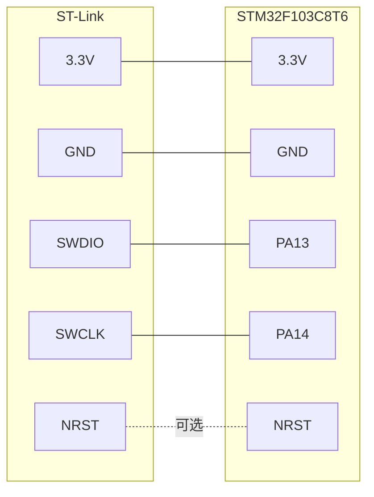

## Linux 命令行烧录详解（ST-Link / OpenOCD / st-flash）

> Windows 那一套是 **串口 ISP**：USB 转 TTL + `BOOT0=1` + FlyMcu。
> 本文是 **Linux 命令行 + ST-Link SWD**：不需要改 BOOT 引脚，速度更快，还能在线调试。
> 命令中的文件名按实际工程路径替换，例如 `2-1 定时器定时中断/Objects/Project.hex`。

### 1. 原理

ST-Link 通过 **SWD 两线调试接口** 直接访问 STM32 内部 Flash：

- `SWDIO` → `PA13`
- `SWCLK` → `PA14`

程序被写入 Flash 起始地址 `0x08000000`。写完后复位，芯片从主 Flash 启动。

和串口 ISP 的区别：

| 项目 | 串口 ISP（Windows 篇） | ST-Link SWD（本文） |
| --- | --- | --- |
| 上位机接口 | USB 转 TTL（USART1） | ST-Link（SWD） |
| BOOT0 | 烧录时必须为 1 | **保持 0 即可** |
| 是否复位进入 Bootloader | 需要 | 不需要 |
| 能否在线调试 | 不能 | 能 |
| 常用工具 | FlyMcu | `st-flash`、`openocd` |
### 2. 一次性准备

#### 1）安装工具

```bash
# Arch / Manjaro
sudo pacman -S openocd stlink arm-none-eabi-binutils

# Debian / Ubuntu
sudo apt install openocd stlink-tools gcc-arm-none-eabi binutils-arm-none-eabi
```

- `openocd`：开源调试/烧录工具，支持 ST-Link、J-Link、DAP 等。
- `stlink` / `stlink-tools`：提供 `st-flash`、`st-info` 命令。
- `arm-none-eabi-binutils`：提供 `arm-none-eabi-objcopy`，用来把 HEX/ELF 转成 BIN。

检查是否安装成功：

```bash
openocd --version     # 打印版本号
st-info --version     # 打印 stlink 工具版本
st-flash --help       # 查看 st-flash 用法
```

#### 2）检查 ST-Link 是否被识别

```bash
lsusb | grep -i st-link
# 正常会看到类似：Bus 001 Device 012: ID 0483:3748 STMicroelectronics ST-LINK/V2

st-info --probe
# 正常会打印芯片型号、Flash 大小、芯片 ID 等信息
```

如果提示 `Permission denied` 或找不到设备：

```bash
# 重新加载 udev 规则（openocd 安装包通常已自带 ST-Link 规则）
sudo udevadm control --reload-rules
sudo udevadm trigger

# 然后重新插拔 ST-Link，再执行 st-info --probe
```

#### 3）接线

| ST-Link | STM32F103C8T6 | 说明 |
| --- | --- | --- |
| `3.3V` | `3.3V` | 给目标板供电；目标板已独立供电时可不接 |
| `GND` | `GND` | **必须共地** |
| `SWDIO` | `PA13` | SWD 数据线 |
| `SWCLK` | `PA14` | SWD 时钟线 |
| `NRST` | `NRST` | 可选，建议接，便于连接和复位 |
| `SWO` | `PB3` | 可选，用于 trace 调试，一般不用 |



> 烧录时 `BOOT0 = 0`、`BOOT1 = 0`，芯片正常运行即可，**不需要**像串口 ISP 那样把 BOOT0 拨到 1。
> 如果目标板已经用 USB 独立供电，只接 `SWDIO`、`SWCLK`、`GND`（最好再加 `NRST`）即可，不要重复供电。

### 3. 生成烧录文件

Keil 编译后通常会得到 HEX 文件：

```text
2-1 定时器定时中断/Objects/Project.hex
```

#### OpenOCD

OpenOCD 可以直接烧录 **HEX、ELF、BIN**，不需要转换：

```bash
# HEX：地址已经包含在文件里
openocd ... -c "program Objects/Project.hex verify reset exit"

# ELF：地址也包含在文件里
openocd ... -c "program Objects/Project.elf verify reset exit"
```

#### st-flash

`st-flash` 只认 **BIN**，所以要先转换：

```bash
# HEX 转 BIN
arm-none-eabi-objcopy -I ihex -O binary Objects/Project.hex Objects/Project.bin

# ELF 转 BIN
arm-none-eabi-objcopy -O binary Objects/Project.elf Objects/Project.bin
```

> BIN 文件本身不包含地址，烧录时必须手动指定 `0x08000000`。

### 4. 使用 st-flash 烧录

`st-flash` 适合只想“烧一下程序”的场景，命令短、速度快。

```bash
# 1）确认能连上芯片
st-info --probe

# 2）烧录 BIN 到 Flash 起始地址
#    --reset：烧录前复位一次，烧录后再复位一次
st-flash --reset write Objects/Project.bin 0x08000000

# 3）只复位芯片，不烧录
st-flash reset

# 4）整片擦除（会把程序全部清掉）
st-flash erase

# 5）读回 Flash，用于备份或校验
#    格式：st-flash read 文件名 起始地址 读取长度
st-flash read Objects/readback.bin 0x08000000 0x10000

# 6）电脑接了多个 ST-Link 时，用序列号指定其中一个
#    下面的 0123456789 换成 st-info --probe 显示的实际序列号
st-flash --serial 0123456789 write Objects/Project.bin 0x08000000
```

常用参数：

| 参数 | 作用 |
| --- | --- |
| `--reset` | 烧录前后各复位一次 |
| `--serial <序列号>` | 选择指定的 ST-Link |
| `--debug` | 输出调试信息，连接失败时有用 |
| `--flash=64k` | 指定 Flash 大小，一般不用手动写 |

> 烧录地址写 `0x8000000` 或 `0x08000000` 都可以，前导 0 可省略。

### 5. 使用 OpenOCD 烧录

OpenOCD 的通用写法是：**先选接口，再选芯片，最后执行命令**。

```bash
# 接口：ST-Link
# 芯片：STM32F1 系列
openocd \
  -f interface/stlink.cfg \
  -f target/stm32f1x.cfg \
  -c "program Objects/Project.hex verify reset exit"
```

参数解释：

| 参数 | 含义 |
| --- | --- |
| `-f interface/stlink.cfg` | 使用 ST-Link 调试器 |
| `-f target/stm32f1x.cfg` | 目标芯片是 STM32F1 系列 |
| `program <文件>` | 烧录文件 |
| `verify` | 烧录后校验 |
| `reset` | 烧录后复位 |
| `exit` | 执行完退出 OpenOCD |

烧录 BIN 时，必须指定地址：

```bash
openocd \
  -f interface/stlink.cfg \
  -f target/stm32f1x.cfg \
  -c "program Objects/Project.bin 0x08000000 verify reset exit"
```

Blue Pill 有一份现成的板级配置，可以少写两行：

```bash
# board 配置已经包含了 interface 和 target
openocd \
  -f board/stm32f103c8_blue_pill.cfg \
  -c "program Objects/Project.hex verify reset exit"
```

> 注意：`stm32f103c8_blue_pill.cfg` 默认按 128KB Flash 处理，部分 C8 芯片实际只有 64KB。如果担心，改用 `interface/stlink.cfg + target/stm32f1x.cfg` 的通用写法，OpenOCD 会自动检测容量。

#### 交互模式（可选）

想连续执行多条命令时，可以先启动 OpenOCD 服务：

```bash
# 终端 1：启动 OpenOCD，保持运行
openocd -f interface/stlink.cfg -f target/stm32f1x.cfg
```

```bash
# 终端 2：用 telnet 连接 OpenOCD 的命令行
# 默认端口是 4444
telnet localhost 4444
```

连接后可以输入：

```text
reset halt                          # 复位并暂停芯片
program Objects/Project.hex verify  # 烧录并校验
reset run                           # 复位并运行
exit                                # 断开 telnet
```

> OpenOCD 同时还会监听 `3333` 端口，供 `arm-none-eabi-gdb` 连接做在线调试；只烧录的话用不到。

#### 其他常用 OpenOCD 命令

```bash
# 擦除从 0x08000000 开始的 64KB Flash
openocd -f interface/stlink.cfg -f target/stm32f1x.cfg \
  -c "init; reset halt; flash erase_address 0x08000000 0x10000; shutdown"

# 只复位并运行，不烧录
openocd -f interface/stlink.cfg -f target/stm32f1x.cfg \
  -c "init; reset run; shutdown"

# 读回 64KB Flash 用于备份
openocd -f interface/stlink.cfg -f target/stm32f1x.cfg \
  -c "init; reset halt; dump_image Objects/readback.bin 0x08000000 0x10000; shutdown"

# 查看目标芯片信息
openocd -f interface/stlink.cfg -f target/stm32f1x.cfg \
  -c "init; targets; shutdown"
```

### 6. 常用配置

| 场景 | 配置 |
| --- | --- |
| ST-Link V2 / V2-1 / V3 | `-f interface/stlink.cfg` |
| 部分 V3 或 DAP 模式 | `-f interface/stlink-dap.cfg` |
| STM32F103C8 | `-f target/stm32f1x.cfg` |
| Blue Pill 整板 | `-f board/stm32f103c8_blue_pill.cfg` |
| 降低 SWD 速度 | `-c "adapter speed 480"`（单位 kHz） |
| 杜邦线很长/连接不稳 | 把速度降到 `480` 甚至 `100` |
| 电脑有多个 ST-Link | `-c "adapter serial <序列号>"` 或 `st-flash --serial <序列号>` |
| 接了 NRST 并需要硬件复位 | `-c "reset_config srst_only srst_nogate"` |

完整示例：

```bash
# 降低速度 + 指定序列号 + 烧录 HEX
# 0123456789 换成 st-info --probe 显示的实际序列号
openocd \
  -f interface/stlink.cfg \
  -f target/stm32f1x.cfg \
  -c "adapter speed 480" \
  -c "adapter serial 0123456789" \
  -c "program Objects/Project.hex verify reset exit"
```

### 7. 快速命令清单

```bash
# 方案一：st-flash（需要先转 BIN）
arm-none-eabi-objcopy -I ihex -O binary Objects/Project.hex Objects/Project.bin
st-info --probe
st-flash --reset write Objects/Project.bin 0x08000000

# 方案二：OpenOCD（直接烧 HEX）
openocd -f interface/stlink.cfg -f target/stm32f1x.cfg \
  -c "program Objects/Project.hex verify reset exit"
```

### 8. 常见问题排查

| 现象 | 可能原因 | 解决方法 |
| --- | --- | --- |
| `st-info --probe` 找不到设备 | 没插好、驱动/udev 权限、线材问题 | 换 USB 口和线，重新加载 udev，检查 `lsusb` |
| `openocd` 提示 `Permission denied` | 当前用户没有 USB 访问权限 | 重新加载 udev 规则，或使用带 `uaccess` 的规则 |
| `Error: init mode failed` | 接线错误、目标没供电、SWD 速度太高 | 检查 SWDIO/SWCLK/GND，降低 `adapter speed` |
| 能识别 ST-Link 但连不上芯片 | 芯片没供电、SWD 引脚被程序占用、需要复位 | 接 NRST，使用复位连接，或降低速度 |
| `st-flash` 报文件格式错误 | 直接喂了 HEX/ELF | 先用 `arm-none-eabi-objcopy` 转成 BIN |
| 烧录成功但程序不运行 | `BOOT0` 仍为 1、没复位、LED 接法不对 | 把 `BOOT0` 接回 0，执行 `st-flash reset` |
| 烧录后 SWD 再也连不上 | 程序禁用了 SWD 引脚或进入低功耗 | 接 NRST，使用 `connect_assert_srst` 重新连接 |
| 多个 ST-Link 分不清 | 同时插了多个调试器 | 用 `--serial` 或 `adapter serial` 指定 |

> 如果程序把 `PA13/PA14` 复用成了普通 GPIO，SWD 会失效。此时需要接好 `NRST`，让 OpenOCD 在复位状态下连接：
>
> ```bash
> openocd -f interface/stlink.cfg -f target/stm32f1x.cfg \
>   -c "reset_config srst_only srst_nogate connect_assert_srst" \
>   -c "program Objects/Project.hex verify reset exit"
> ```

## 串口 ISP 烧录详解（windows）

### 1 原理

STM32F103 出厂时，芯片内部系统存储器（System Memory）中固化了一段 **Bootloader**。当复位时检测到：

```text
BOOT0 = 1，BOOT1 = 0
```

芯片不会运行用户 Flash 中的程序，而是运行这段系统 Bootloader。Bootloader 通过 **USART1（PA9/PA10）** 接收上位机发来的程序，并写入主 Flash。烧录完成后，把 BOOT0 改回 0 再复位，芯片就从主 Flash 启动，运行刚下载的程序。

因此串口 ISP 的关键三步是：

1. **接线正确**：USB 转 TTL 的 TX/RX 交叉接到 PA10/PA9，并共地。
2. **进入 Bootloader**：BOOT0=1、BOOT1=0，按复位。
3. **上位机下载**：FlyMcu 选择 HEX 文件并开始编程。

### 2 一次性准备

#### 1）安装 USB 转串口驱动

以 CH340 为例：

1. 把 USB 转 TTL 插入电脑。
2. 安装 CH340 驱动（Windows 10/11 也可能自动安装）。
3. 打开“设备管理器 → 端口（COM 和 LPT）”，确认出现类似 `USB-SERIAL CH340 (COM3)` 的设备。
4. 记住 COM 号，FlyMcu 中要选择同一个端口。

如果设备管理器中出现黄色感叹号，说明驱动未装好；如果插拔后没有反应，先换一根 **支持数据通信** 的 USB 线。

#### 2）安装 FlyMcu

FlyMcu（旧称 mcuisp）是常用的 STM32 串口 ISP 下载软件。打开后主要用到以下区域：

- 端口选择
- 波特率
- HEX 文件选择
- “开始编程”按钮
- 下载日志窗口

#### 3）用 Keil 生成 HEX 文件

工程默认已经开启 HEX 输出，输出路径为：

```text
1-1 LED闪烁/Objects/Project.hex
2-1 定时器定时中断/Objects/Project.hex
```

如果没有生成，按以下步骤设置：

1. 打开 Keil 工程。
2. 点击 `Options for Target`（魔术棒图标）。
3. 进入 `Output` 选项卡。
4. 勾选 `Create HEX File`。
5. 点击 `OK`，按 `F7` 重新编译。
6. 在 `Objects` 目录下找到 `Project.hex`。

> 注意：Keil 编译成功不等于已经下载，必须把 HEX 文件通过 FlyMcu 烧录进芯片。

### 3 进入 Bootloader

1. 断开 STM32 电源。
2. 把 BOOT0 跳线帽从 `0` 改到 `1`。
3. 确认 BOOT1/PB2 为低电平（多数板子默认已下拉）。
4. 给 STM32 上电。
5. 按一下 `NRST` 复位键（重新上电也可以）。
6. 此时芯片进入系统 Bootloader，等待串口下载。

> 如果板子上没有 BOOT0 跳线帽，可以用杜邦线把 BOOT0 接到 3.3V，烧录完成后再接回 GND。

### 4 FlyMcu 配置

| 配置项 | 推荐值 | 说明 |
| --- | --- | --- |
| 端口 | CH340 对应的 COM 口 | 在设备管理器中确认 |
| 波特率 | `115200` | 不稳定时可降到 `57600` 或 `38400` |
| 校验位 | 无 / None | FlyMcu 默认即可 |
| 数据位 | 8 | 默认 |
| 停止位 | 1 | 默认 |
| HEX 文件 | `Objects/Project.hex` | 选择刚编译出的文件 |
| 编程后执行 | 勾选 | 下载完成后尝试运行 |
| 校验 | 勾选 | 下载后校验数据 |
| DTR/RTS 自动控制 | 可选 | 需模块 DTR/RTS 已接到 NRST/BOOT0 |

如果 USB 转 TTL 模块引出了 `DTR` 和 `RTS`，可以这样接，实现 FlyMcu 自动复位并进入 Bootloader：

```text
USB-TTL DTR ── 0.1μF 电容 ── STM32 NRST
USB-TTL RTS ──────────────── STM32 BOOT0
USB-TTL GND ──────────────── STM32 GND
```

然后在 FlyMcu 中勾选类似 **“DTR 的低电平复位，RTS 高电平进 BootLoader”** 的选项。没有 DTR/RTS 时不必强求，手动设置 BOOT0 并按复位即可。

### 5 下载步骤

1. 按 5.3 节让芯片进入 Bootloader。
2. 打开 FlyMcu，选择正确的 COM 口和 `115200` 波特率。
3. 点击“选择文件”，选中 `Objects/Project.hex`。
4. 勾选“校验”和“编程后执行”。
5. 点击 **“开始编程”**。
6. 观察日志窗口，正常情况下会依次出现：
   - 连接芯片成功
   - 擦除 Flash
   - 写入程序
   - 校验成功
   - 编程完成
7. 下载完成后，把 BOOT0 跳线帽改回 `0`。
8. 按一下 `NRST` 复位键，程序开始运行。

### 6 常见问题排查

| 现象 | 可能原因 | 解决方法 |
| --- | --- | --- |
| 设备管理器没有 COM 口 | 驱动未装、USB 线只能充电、模块损坏 | 装 CH340 驱动，换数据线，换 USB 口 |
| FlyMcu 一直等待/连接超时 | BOOT0 没置 1、没按复位、TX/RX 接反、未共地 | 检查 BOOT0=1，按 NRST，交换 TX/RX，接好 GND |
| 能识别芯片但下载失败 | 波特率过高、供电不稳、HEX 文件不对 | 降到 57600，换供电，确认选对 HEX |
| 下载成功但程序不运行 | BOOT0 仍为 1、没复位、LED 接法不对 | BOOT0 改回 0，按复位，检查 LED 极性 |
| 芯片发烫 | 电源短路、5V 误接 3.3V、LED 没限流 | **立即断电**，检查接线 |
| 提示 Flash 容量不足 | 芯片型号选错或程序超过 64KB | 确认器件为 STM32F103C8，精简程序 |
| 下载后再次无法连接 | 程序禁用了调试口或进入低功耗 | 重新设置 BOOT0=1 并复位，进入 Bootloader |

> 串口 ISP 的通信参数本质上是 **115200、8 数据位、1 停止位、偶校验（8E1）**，FlyMcu 会自动处理；如果使用其他串口 ISP 工具，需要手动设置 8E1。
### 串口助手（暂时不需要）

---
